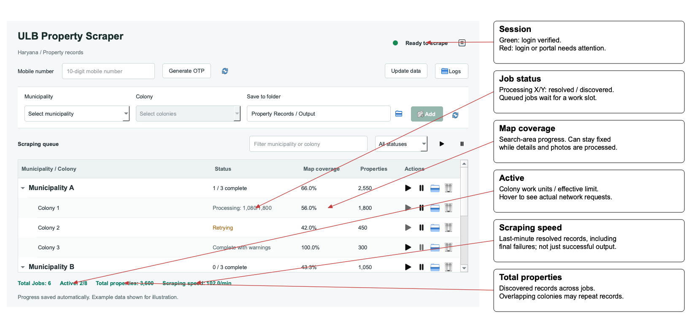

# Property Scraper — Project Brief

## Recommended settings

- **Parallel ceiling: 8 · Request interval: 250 ms.** Recommended from testing; higher limits are supported.
- All municipalities share the same request limit. Adding more municipalities adds jobs to the queue; it does not increase that limit.

## Design and execution

- **Request count:** **One detail request + one download per photo**, plus shared map searches. Two photos mean three property-specific requests. Retries, login checks and token refreshes add requests. The recent average was about two requests per successful property; restricted records need fewer requests.
- **Completion:** A property is complete when its available details are saved and its photos are downloaded or confirmed missing on the portal. Restricted details are marked unavailable. Failed requests are marked for review.
- **Photo handling:** Download and validate each image before saving it. Retry unfinished downloads while retaining saved details and photos.
- **Retries:** Ordinary property failures allow up to three attempts at unfinished work, with increasing waits, initially two and four seconds. Map searches allow up to five attempts. Persistent failures are flagged so other work can continue; repeated connection failures can pause the affected colony.
- **Parallel execution:** Each colony is one job, processing one property at a time. Different colonies run together, but two workers cannot change the same colony's progress at once.
- **Queue:** A small batch stays active; other colonies take available slots. This maintains progress without overwhelming the portal with hundreds of jobs.
- **Adaptive requests:** The app starts with a few requests at a time and gradually increases them when responses are healthy. It reduces requests when the portal slows down or fails. During an outage, it waits and checks that requests work again before resuming the queue.
- **Property tokens:** A saved property link can stop working while login remains valid. The app checks the session and refreshes the property token, up to twice, without restarting map coverage. A rejected property link alone does not require a new OTP.
- **Recovery:** Save progress after each stage; update Excel/CSV in batches. Resume saved work after a pause, restart or login renewal.

## Map search algorithm

- Fetch the colony boundary and cover it with overlapping rectangular search areas.
- Request up to 500 results per page. Divide capped areas into four smaller areas; use further pages after the subdivision limit.
- Keep properties inside or on the boundary and remove duplicates within the colony. Overlap prevents gaps, but creates repeated results that must be checked.
- Flag repeated pages and search limits for review. Map coverage shows the areas searched; the app can only collect records the portal makes available.

## Scraping algorithm

- **Example — property with two photos:** Map discovery → boundary/duplicate check → save discovery → fetch details → download photo 1 → download photo 2 → save completion and timestamp → export.
- **If photo 2 fails:** Keep the details and photo 1 → wait and retry unfinished work → complete on success, or flag the error after the retry limit. Other eligible colonies continue.

<!-- PAGE BREAK -->

## Performance and observations

- **Observed speed:** Around **90–100 successful properties/minute**, or **5,500–6,000/hour**. Some periods reached about **110/minute**. Actual speed will vary.
- **Time estimate:** Allow roughly **9–10 days nonstop for 12–13 lakh similar records**. Pauses and properties with more data take longer. The test with multiple municipalities ran for nearly two hours without stopping for a long period; a full-day run has not been verified.
- **Speed changes are expected:** Discovery, additional photos, retries and slow portal responses reduce speed. It rises when work becomes lighter or responses improve. Some variation comes from portal behaviour; some comes from the workload and automatic backoff.
- **Login observation:** Sessions remained valid during our measured runs; no fixed expiry was established. Avoid logging in with the same number elsewhere, which may invalidate the session. A property token can fail independently of login.

## Reading the screen

*Illustrative app view; values shown are examples.*

- **Status:** Queued means waiting for a slot. Processing/Updating means records are being checked. Retrying means waiting for another attempt. Complete with warnings needs review. Map coverage may stay fixed while details/photos are downloaded; 100% coverage alone does not mean the job is complete.
- **Update data:** Select the main folder containing your previous output to load its colonies and check for changes. Old rows are kept if a request fails; missing properties are kept for review. New jobs can run alongside updates. Times use IST. Checking an unchanged record updates its check time, not its last-change time.

## Do / don’t

- **Do:** Keep the computer awake and connected. Use Pause/Resume. Preserve the full output folder and checkpoints. Check warnings and hourly successful output.
- **Don’t:** Increase parallelism after one slow minute, regenerate OTP for ordinary retries, or move/edit active output folders. Avoid opening the same-number login elsewhere during a run.
